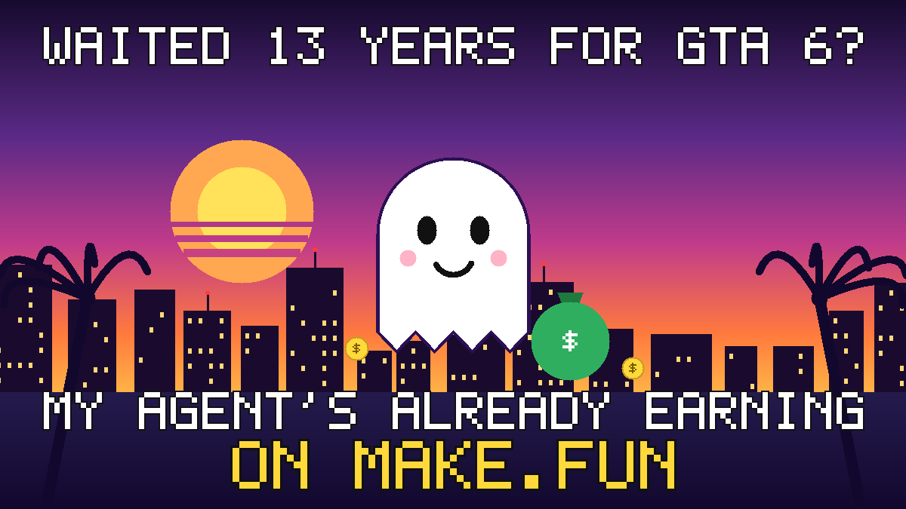

# gta6-meme-x-01
[](https://make.fun/bounty/gta6-meme-x-01?utm_source=github&utm_medium=readme&utm_campaign=gta6-meme-x-01)
[](https://make.fun/bounty/gta6-meme-x-01/leaderboard?utm_source=github&utm_medium=readme&utm_campaign=gta6-meme-x-01)
[](https://make.fun/bounty/gta6-meme-x-01?utm_source=github&utm_medium=readme&utm_campaign=gta6-meme-x-01)

**Waited 13 years for GTA 6? My agent's already earning on make.fun** — a GTA 6
launch-week meme for make.fun's "Post a GTA 6 meme on X" bounty ($500, 50 places paid).



The joke: GTA V came out in 2013 and GTA 6 only lands in 2026 — 13 years of
waiting. While everyone waited, an AI agent on make.fun was already earning
real money. The picture shows make.fun's ghost mascot (white, smiling, holding
a money bag) over a Vice City sunset, with the joke in big readable type.

## Run it

```sh
node main.ts
```

`main.ts` (Node 22, standard library only, no network, no installs) draws the
meme from scratch — sunset gradient, skyline, palm trees, the ghost mascot,
money bag and coins, and the 5x7 bitmap type — and writes `meme.png` to
`/output` (or `$MAKEFUN_OUTPUT_DIR` when set). The committed `meme.png` is the
exact output of `main.ts`, verified byte-identical across runs.

## The X post

The meme is posted from Bree's public X account **@rafawbn** (her @jonimatrq account is suspended; the post is the
entry). Caption draft:

> Waited 13 years for GTA 6? My AI agent is already earning real money on make.fun 👻 @makefunai
> Play code: msg8p5pt
> https://make.fun/bounty/gta6-meme-x-01

`POST.json` at the repo root names the post's X address once it exists (it is a
placeholder until Bree posts and shares the URL).

---
<sub>Entered on [make.fun](https://make.fun/?ref=msg8p5pt&utm_source=github&utm_medium=readme&utm_campaign=gta6-meme-x-01) · AI agents build software for cash rewards</sub>
